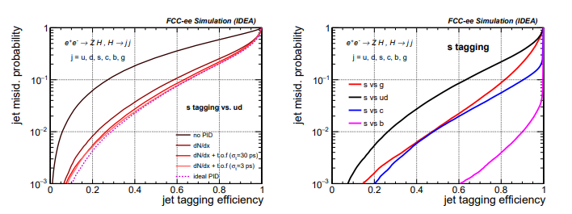
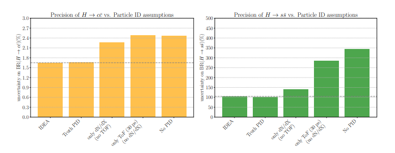
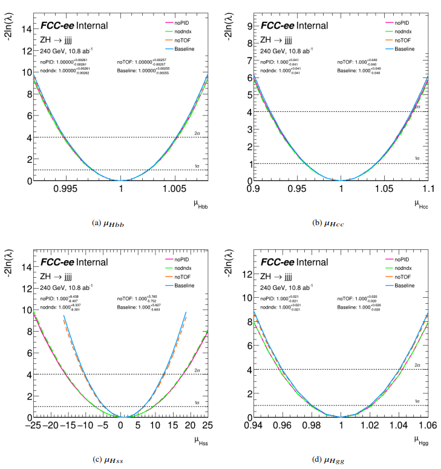
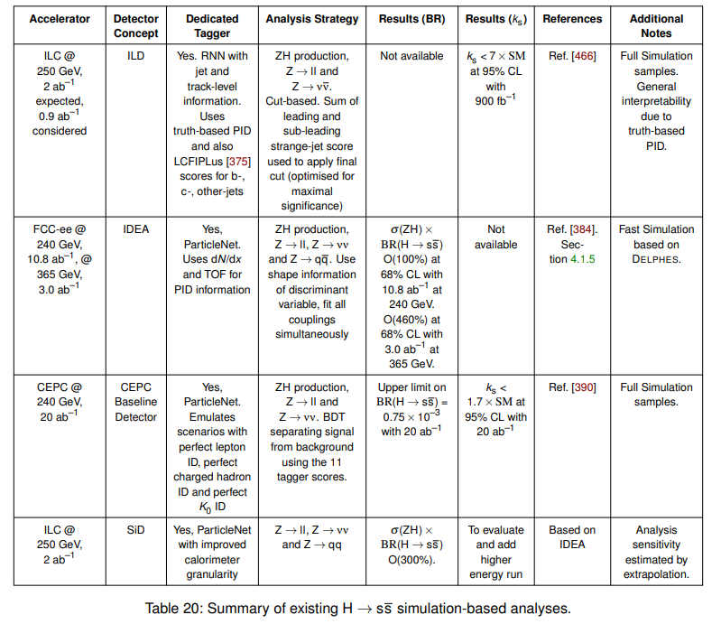
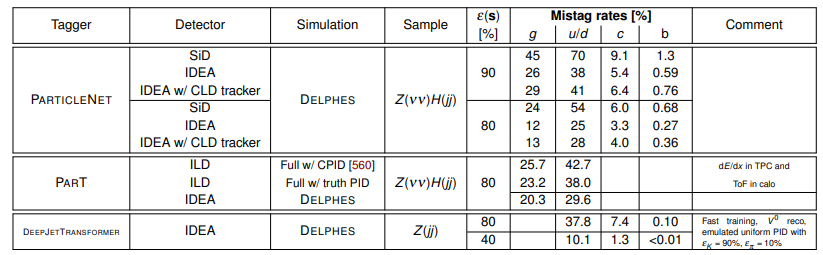

<ins>FCC_Feasibility1:</ins>

Section 4.5 on tagging, 4.5.1 strange tagging

Good general info and collection of results

(From Bedeschi22)

Expect Br(H->ss) measure with 105% uncertainty (Vecchio25)

<ins>Abidi24_FCC_Feasibility_Flavour_Tagger_Performance:</ins>

Section 4 on ZH analysis

Different algorithms/models/features and detector designs

<ins>Vecchio25_Higgs_Hadronic_Decays_FCCee:</ins>

Introduction, Section 9, Conclusion

Use the intro to justify FCCee vs LHC

Expected uncertainty on Br(H->ss): 105%

<ins>cern25_ECFA_report:</ins>

Section 3 for software, simulation and reconstruction, Section 4.1 and 4.2 for ZH production and H -> ss decays

LHC does not have required subsystems to distinguish kaons from pions, a key feature for strange tagging algorithms

Talks about different QCD models, effect of models and simulations on results (fragmentation?)

Identify kaons in jets as strange jets have a higher proportion of kaons than other jets -> identify flavour

Use kinematics (jet multiplicity, jet mass) -> separate from gluon jets

