<ins>Duarte20_Probing_Strange_Higgs_Coupling:</ins>

Signal strength: μss = measured branching ratio / SM prediction

Upper bound (LHC): μss < 7.2e8

Define Jet flavour variable
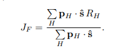

Based on truth-level info, without full detector sim

Use PID of Kaons and Pions, particularly K_S as it decays in a distinguishable manner

Kaons formed from strange quarks have a tiny impact parameter compared to those from bottom or charm due to lifetimes

These are typically used to identify heavy candidates -> reuse to veto heavy candidates

Find: μss < 14, 7, 60 for integrated luminosities 5, 20 ab-1 and 250 fb-1 

<ins>Albert22_Strange_Quark_as_a_Probe:</ins>

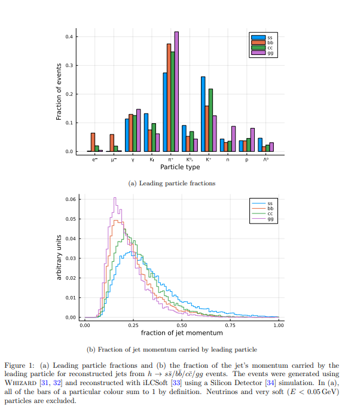

Info on neural networks and different tagging scores, confusion matrix

Great graphs on cuts made and cut flow

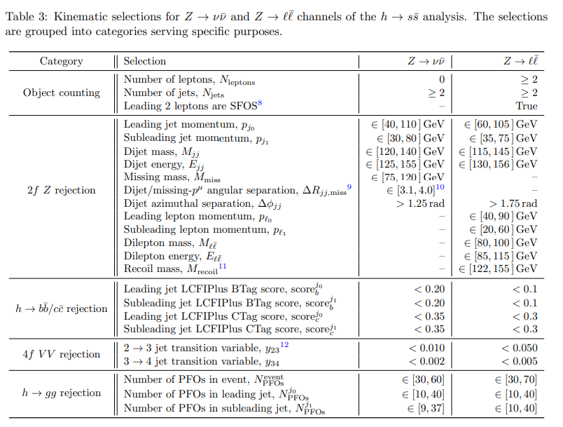

<ins>Bedeschi22_Tagging_Future_Colliders_Fast_Sim:</ins>

Gluons larger colour charge than quarks -> larger particle multiplicity

Advances in neural networks, low-level info from reconstructed particles/hits, particle ID via ionisation energy loss (dE/dx or dN/dx) and time-of-flight measurements, computing developments

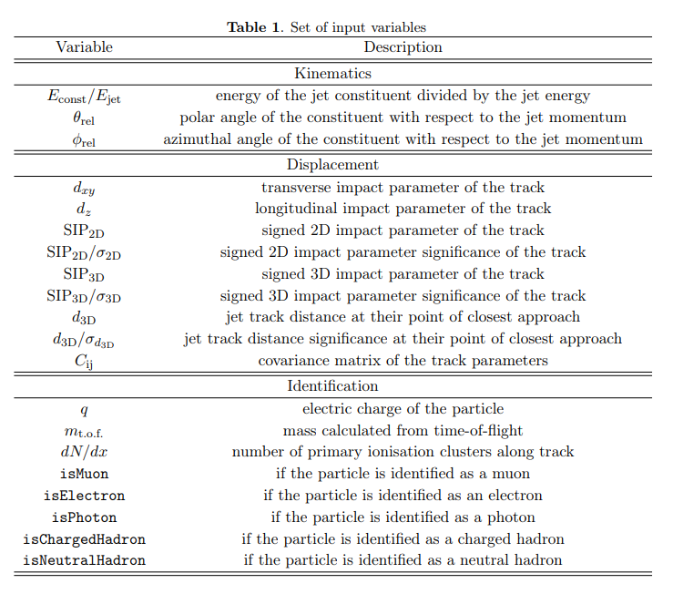

Based on ParticleNet jet tagging algorithm which uses Graph Neural Networks

Jets represented as unordered sets of particles (alternatively jet images, ordered lists of jet constituents)

Hierarchical learning approach with convolutional layers to learn features at different scales (shallow layers learn local neighbourhood info, deep layers learn global structures)

Up to 75 constituents for each jet sorted by highest momentum, typically covers 99% of total jet momentum

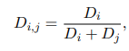

Uses binary discriminant for each flavour pair, represents efficiency of tagging flavour i against flavour j

Efficiency of tagging i as function of probability of misidentifying jet as j constructed by computing the probability of selecting jets that satisfy Di,j > α

Receiver operating characteristic curve is the mistag rate as a function of the tagging efficiency (for every α)

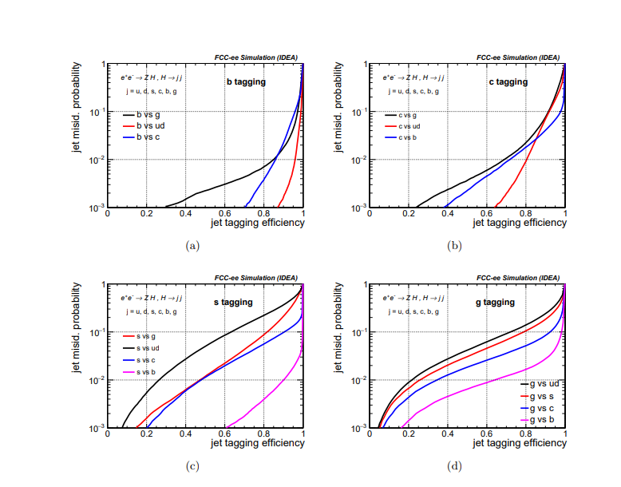

<ins>Blekman25_Tagging_at_FCCee_91GeV_TransfomerNN:</ins>

Z -> qq

References to DNN, RNN, CNN, GNN -> read

Graph-based best,  in combination with a self-attention mechanism called a Transformer

Particle Transformer (ParT) and DeepJetTransformer

Gluons -> colour factor, heavy flavour -> displaced vertices

But strange treated identically to up and down (by QCD and electroweak) in massless limit prior to decay

Same points on kaon vs pion distinguishability, good detail on reconstruction

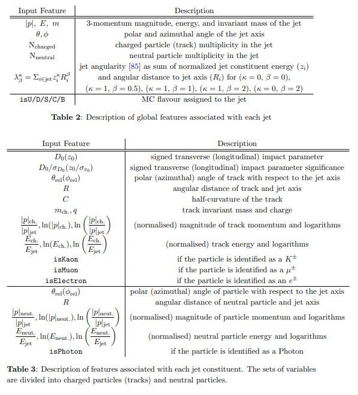

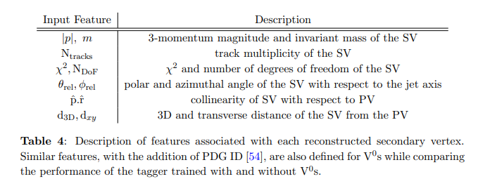

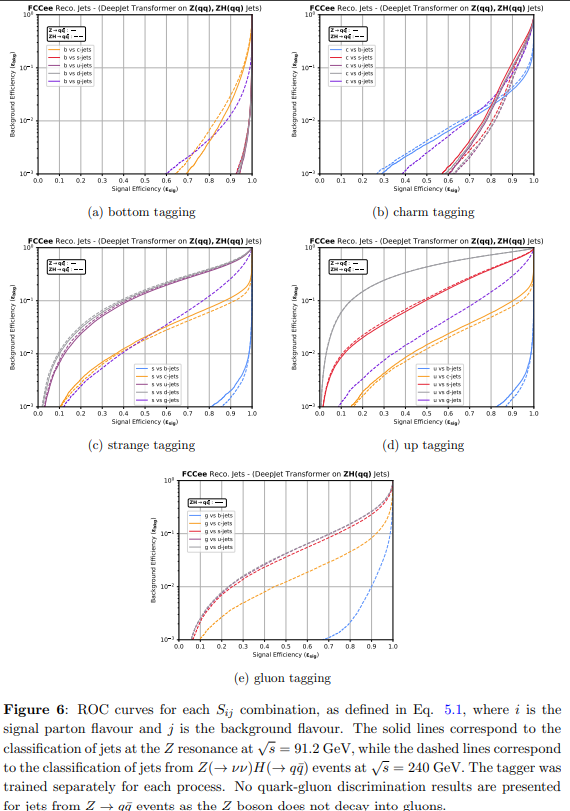

Some comparisons and dependency analysis on PID, presence of neutral kaons, different variables, flavour definition

Realistic performance simulation at end

<ins>Liang24_Jet_Origin_ID_at_ee_Higgs_Factory:</ins>

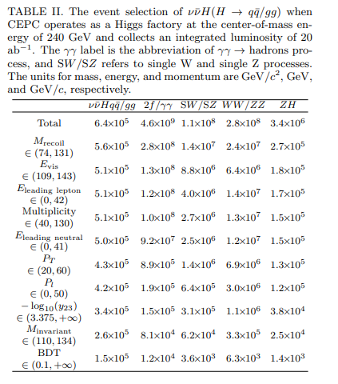

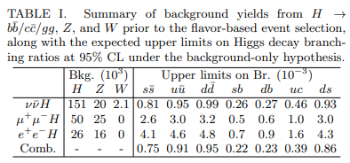

3x SM prediction for H->ss
