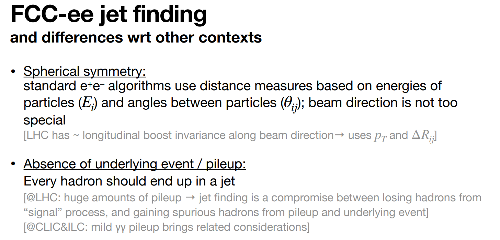
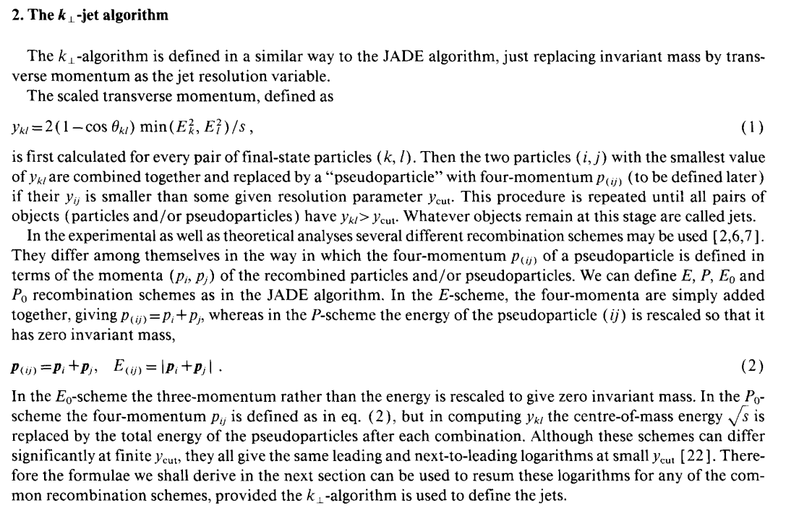

At lepton colliders common to use the Durham (e+e-kt algorithm)

FastJet has a Durham algorithm function, used in the helper from the tutorial

<ins>FCCee_powepoint_Durham:</ins>

Compare energies of pairs of particles
Recombine pair with smallest distance (adding their momentums to form pseudojet)
Add pseuodojet back into set of particles
Keep recombining and comparing
Until you have formed n jets

<ins>Durham_Algorithm</ins>

Delphes and the JetFlavourTagger provided in the tutorial both use Durham algorithm