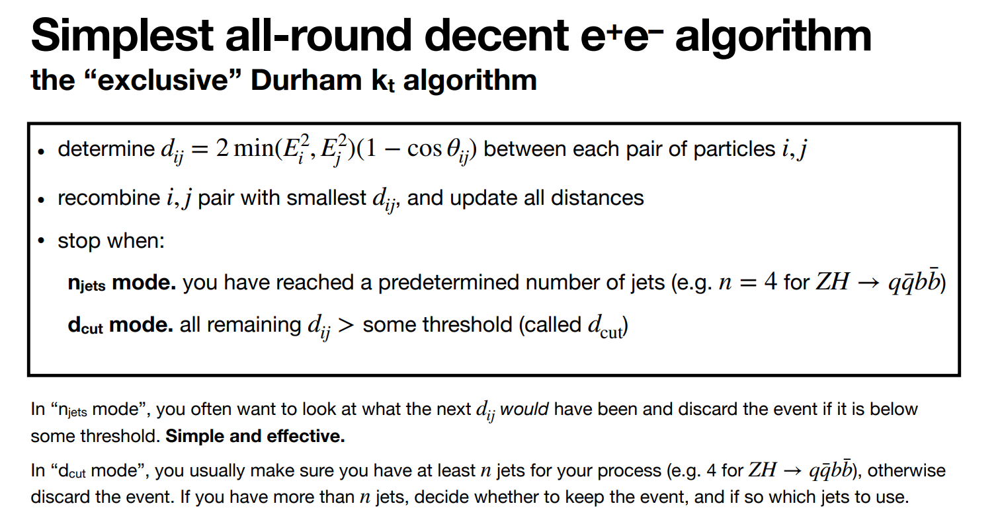

At lepton colliders common to use the Durham (e+e-kt algorithm)

<ins>FCCee_powepoint_Durham:</ins>

Compare energies of pairs of particles
Recombine pair with smallest distance (adding their momentums to form pseudojet)
Carry on until you have formed n jets