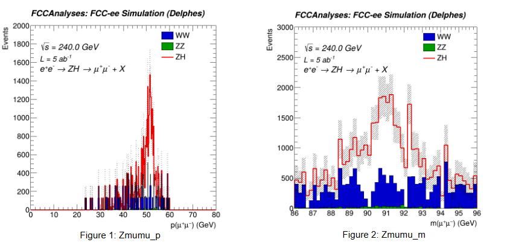
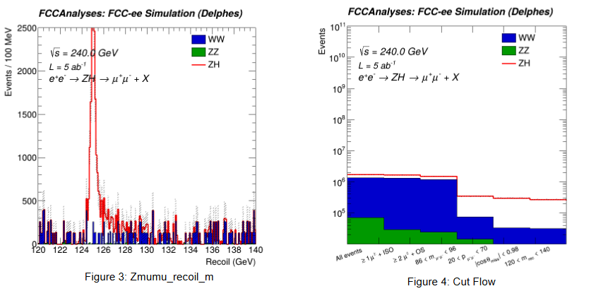

FCC tutorials:
https://hep-fcc.github.io/fcc-tutorials/main/index.html

Will work through Section 3:
https://hep-fcc.github.io/fcc-tutorials/main/3-analysis/README.html

Beginning with 3.1:
https://hep-fcc.github.io/fcc-tutorials/main/3-analysis/3-1-higgs-analysis/README.html

#### 3.1.1 - Recoil Mass

Data:
- p8_ee_ZH_Zmumu_ecm240 
- p8_ee_WW_mumu_ecm240
- p8_ee_ZZ_mumubb_ecm240

Cuts:
- At least one muon with at least one isolated event (sufficiently above background?)
- At least 2 opposite-sign leptons
- Z mass window (86 < reconstructed mass < 96)
- Z momentum (20 < reconstructed momentum < 70)
- cos(theta)  of missing momentum < 0.98
- 120 < recoil mass < 140

#### 3.1.2 - Jet Flavour

Data:
- p8_ee_ZH_Zmumu_ecm240
- p8_ee_ZZ_mumubb_ecm240

Cuts:
- At least one muon with at least one isolated event
- At least 2 opposite-sign leptons
- NJets = 2
- Z mass window (86 < reconstructed mass < 96)
- Z momentum (20 < reconstructed momentum < 70)
- 120 < recoil mass < 140
- Jet1_Bscore + Jet2_Bscore > 1

