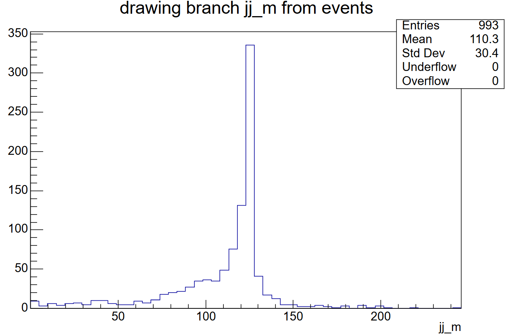
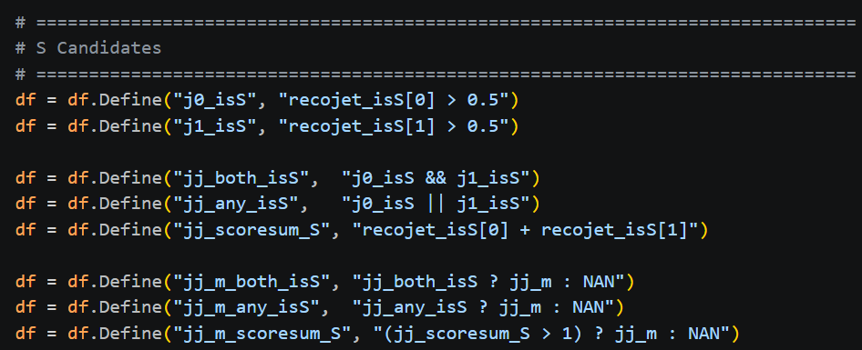
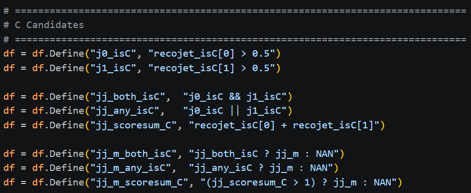
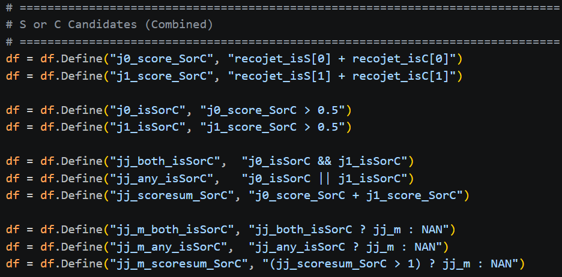

Wanted to explore the Jet Flavour Tagger in FCCAnalysis

Data file: p8_ee_ZH_Zmumu_ecm240_edm4hep

Using this data file as it produces a Higgs, which we are interested in. As this data has forced the decay of the Z boson to muons, the only other products in the interaction will come from decays of the Higgs.

This file does only contain 1000 events though.
Higgs branching ratio to strange quarks is ~0.02% so do not actually expect to see any Higgs -> ss (0.2 strange decays in 1000 events) 

Higgs branching ratio to charm quarks is ~3% so expect to see 30 H -> cc

Higgs also decays to W (~25%) and Z (~2.7%)
W -> cs/us ~33% (83 in 1000 events)
W -> cs/cd ~33% (same as cs dominant)
Z -> ss ~15.6% (4)
Z -> cc ~12% (3)

Expect these to be the main source of background

First removed the muons, found the jets, filtered by interactions containing more than 1 jet, then calculated the invariant mass of the jets

First selection is each jet tagged with a strange score > 0.5 (very likely strange)

Get jets where:
- both jets were tagged strange
- jet 1 or jet 2 was tagged as strange
- the sum of strange scores for both jets > 1 (more lenient)

Get the invariant mass for each of these selections

Repeat for charm quarks

And then for combined strange and charm quarks

