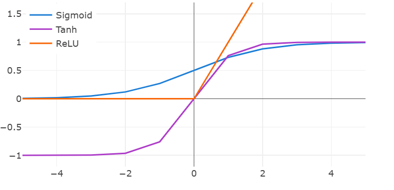

https://apxml.com/courses/introduction-to-neural-networks

### Basics

Each neuron has:
- Inputs (x1, x2, ..., xn)
	- fed into each neuron from other neurons
- Weights (w1, w2, ..., wn)
	- each input has an associated weight representing the strength/importance of that input
	- learnt during training
- Bias (b)
	- associated with the neuron itself
	- makes it easier/harder to activate
	- learnt during training

Each neuron calculates the weight sum of its inputs:
$$
z = (w_1 x_1 + w_2 x_2 + \cdots + w_n x_n) + b = \left(\sum_{i=1}^{n} w_i x_i\right) + b
$$
$$
z = \mathbf{w} \cdot \mathbf{x} + b
$$
This is then passed to an activation function, which introduces non-linearity:
$$
a = f(z) = f\left(\left(\sum_{i=1}^{n} w_i x_i\right) + b\right)
$$
Training is optimising the values of these weights and biases to minimise the difference between the network's predictions and the target values in the training data.

Typically initialised with random values, then adjusted through iterations.

### Activation functions

If neurons only calculated the linear combination, $z$, they would only be able to learn linear relationships.

Need activation function to introduce non-linearity.

#### Sigmoid
$$
\sigma(z) = \frac{1}{1 + e^{-z}}
$$
Output range: (0, 1)
Shape: smooth 's'

At extreme values of $z$, gradients become extremely small causing problems when the network updates weights

Not zero-centred, can slow down learning

#### Tanh
$$
\tanh(z) = \frac{e^z - e^{-z}}{e^z + e^{-z}} = 2\sigma(2z) - 1
$$
Output range: (-1, 1)
Shape: smooth 's'

Also suffers from vanishing gradients

But is zero-centred, can help speed up convergence in training

#### ReLU
$$
\text{ReLU}(z) = \max(0, z)
$$
Output range: $[0, \infty)$
Shape: 0 for all negative $z$, linear for positive values

Fast to compute and mitigates vanishing gradients

However, if a neuron's $z$ is consistently negative during training, it will always output 0. The gradient through this neuron is also 0 and its weights will never be updated - dying ReLU problem.

Also not zero-centred

Hidden layers
- Use ReLU, Leaky ReLU, GeLU, SwiGLU

Output layer
- Binary classification - Sigmoid
- Multi-class classification - Softmax (outputs prob. distr. across classes)
- Regression - no activation function (or a linear one instead) 

### Architecture
