In LLMs, attention allows other words within the same phrase, sentence, paragraph, chapter to "attend" to each other - ie it allows them to share information and encode additional contextual information for each word

eg:

"table" - many different types of table

"They were playing snooker. He leant on the table." - it is a snooker table

Previous words in a previous sentence encode information about the word "table".

### Query - what am I looking for?

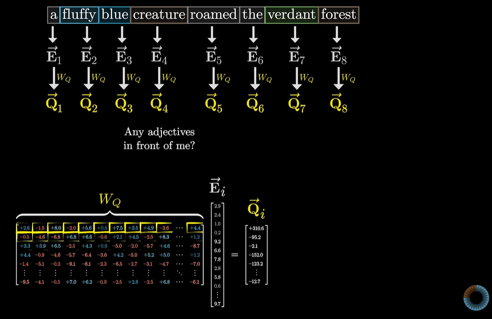

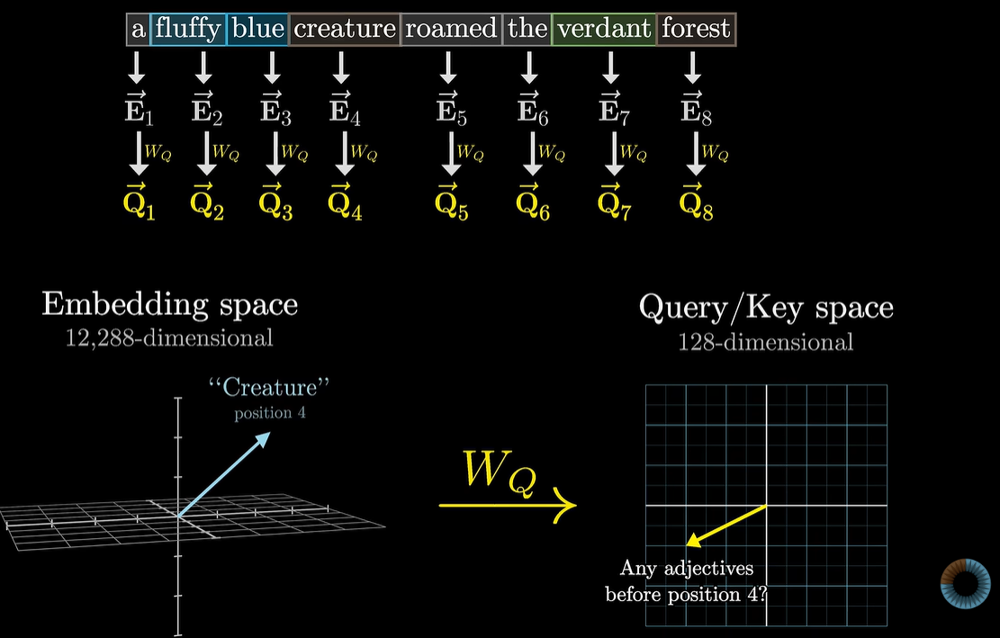

### Key - what do I represent?

### Dot product - how well we match?

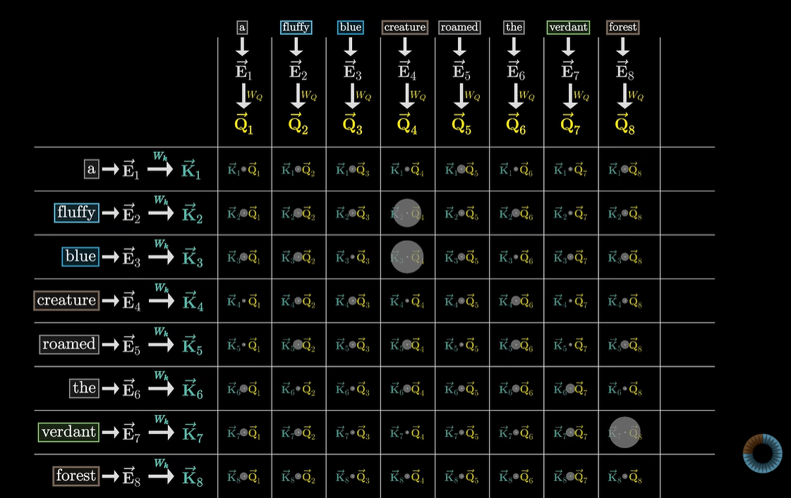

Taking the dot product of each key and query shows how well they align. Larger dot product means closer alignment - ie key matches the query

Softmax is then applied to each dot product to act like weights. Each column gives a weight for how relevant the word is on the left to the corresponding value at the top 

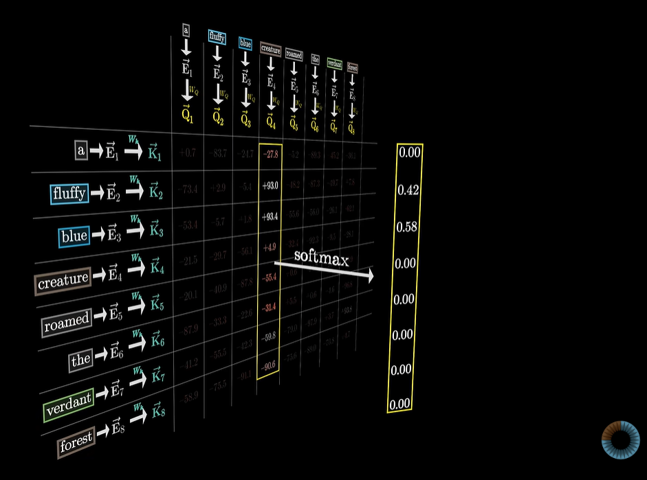

Final grid is an "attention pattern"

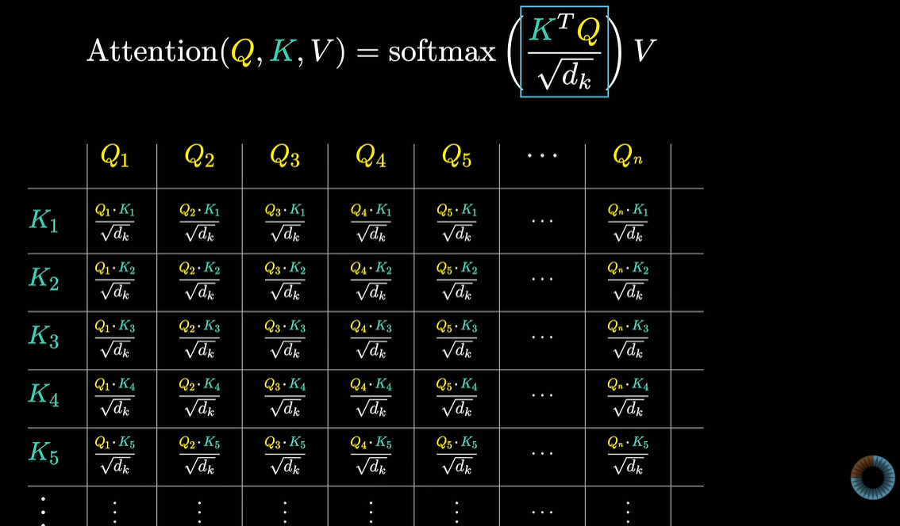

Divide by square root of dimensions in the key-query space for numerical stability

### Value - What information do I pass along if matched?

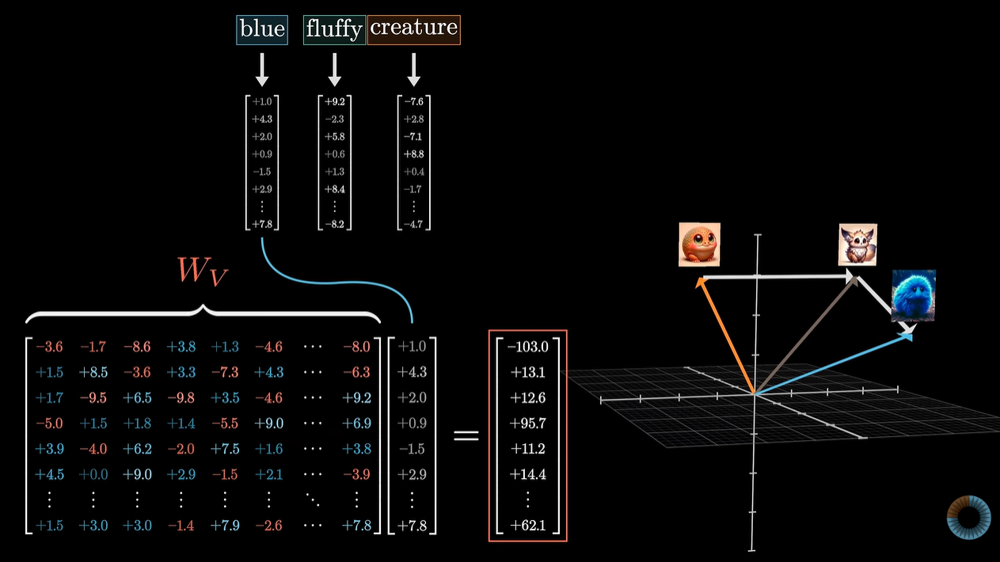

If word is relevant to the meaning of something else, what needs to be added to that something else to change its meaning?

This is what the value matrix does

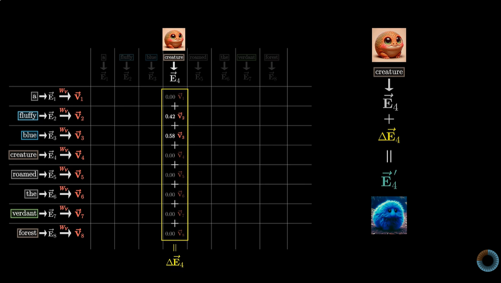

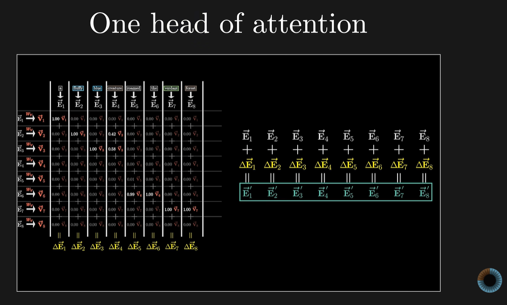

Self-attention - queries and keys are produced between values of the same dataset

Cross-attention - queries and keys correspond to two separate datasets, useful for tasks like translation or speech-to-text

More efficient for number of parameters in value map to be the same as in the query and key maps

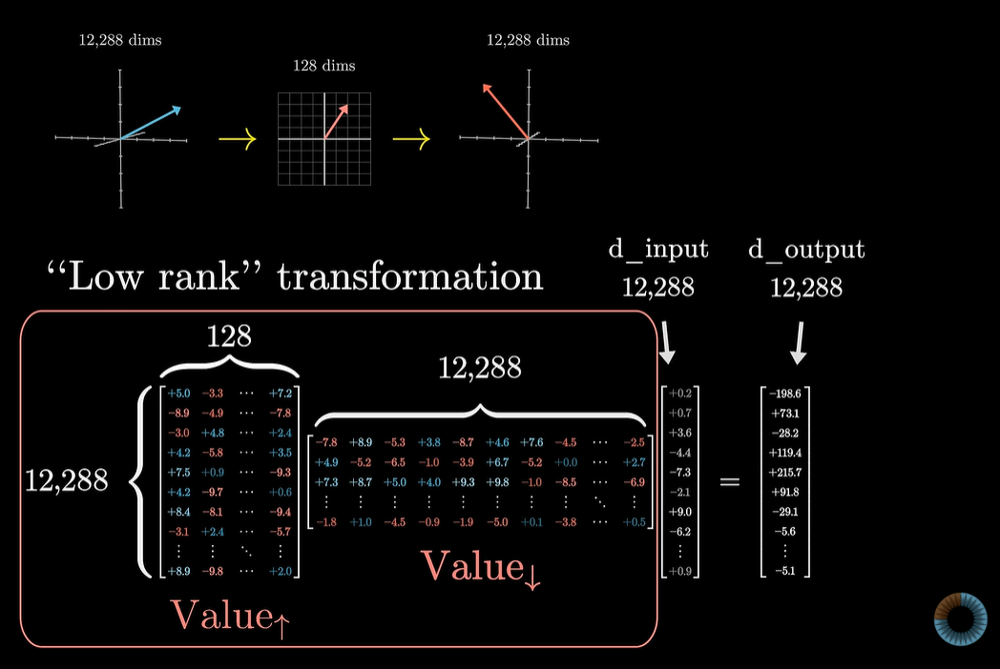

### Multi-head attention

Each head is capable of learning different contextual structures

Eg one head could learn effect of the previous word, another the previous sentence, another the previous paragraph

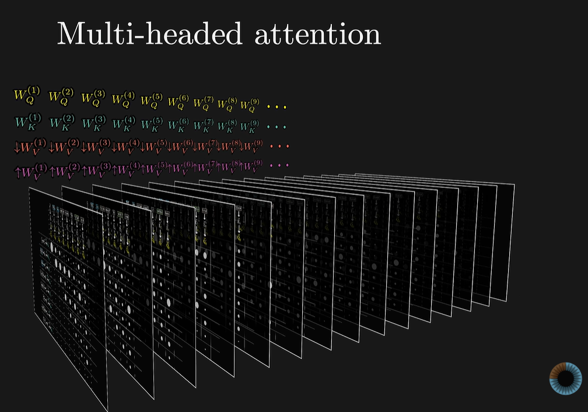

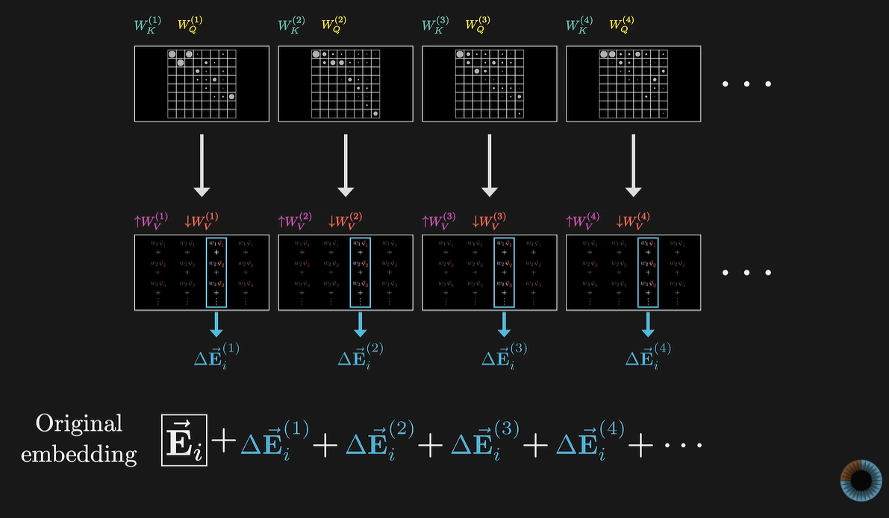

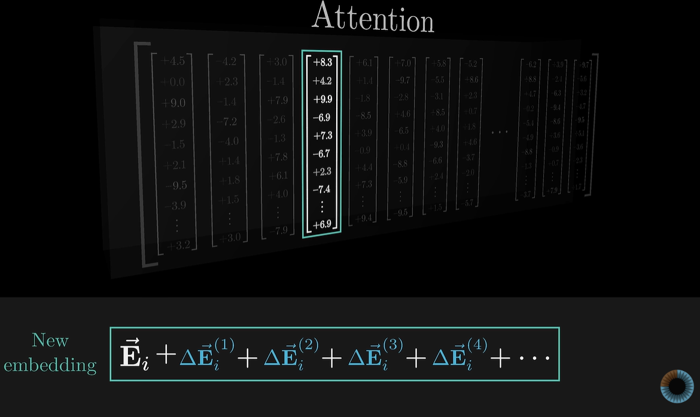

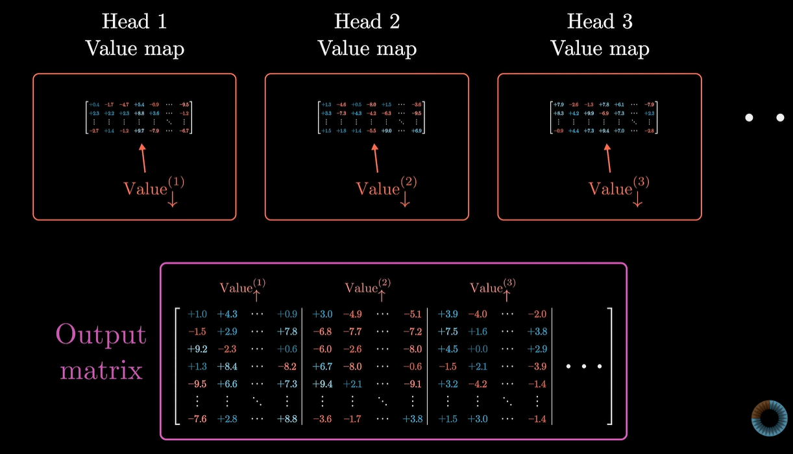