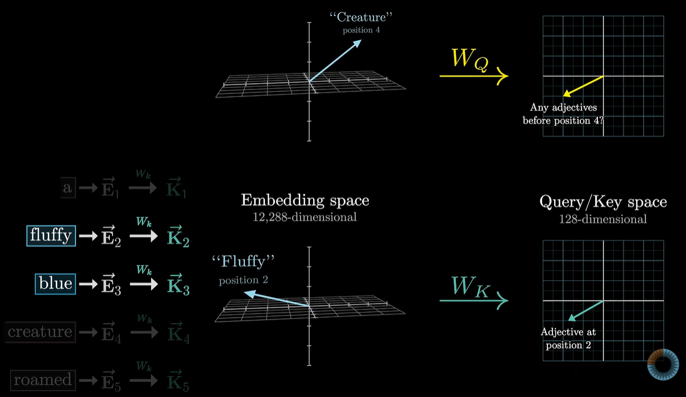

In LLMs, attention allows other words within the same phrase, sentence, paragraph, chapter to "attend" to each other - ie it allows them to share information and encode additional contextual information for each word

eg:

"table" - many different types of table

"They were playing snooker. He leant on the table." - it is a snooker table

Previous words in a previous sentence encode information about the word "table".

### Query - what am I looking for?

### Key - what do I represent?

Taking the dot product of each key and query shows how well they align. Larger dot product means closer alignment - ie key matches the query