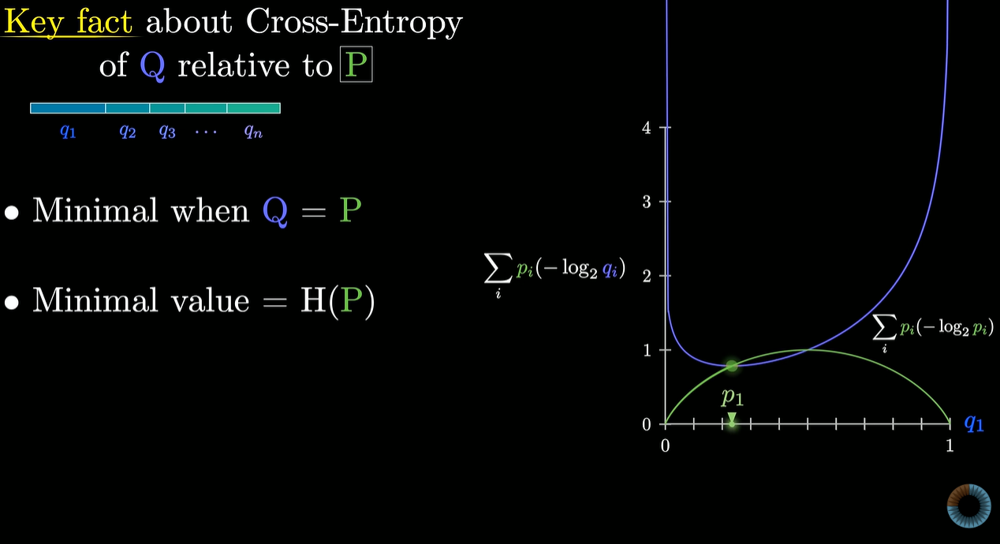

Average number of bits required to encode P with a scheme optimised for Q

Consider a binary scheme:

The minimum of cross-entropy when $p=q$

Plotting the cross-entropy for different values of $q$, the minimum follows the distribution of the entropy for $P$.