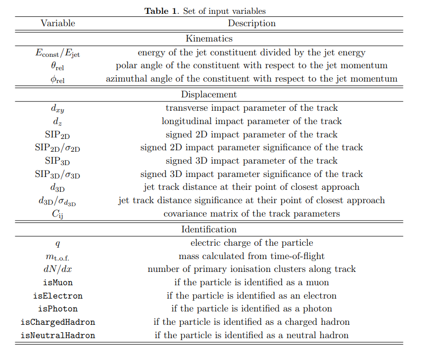

The model provided in FCCAnalysis and the tutorials is:

Bedeschi22_Tagging_Future_Colliders_Fast_Sim

These are the input features

<ins>Kinematics - 3:</ins>
- pfcand_erel_log
- pfcand_thetarel
- pfcand_phirel

Relative energy and direction of each particle wrt jet axis

Learn spatial shape and energy distribution (fragmentation) of jet

<ins>Track Displacement and Covariance Matrix (Cij)- 33:</ins>
- pfcand_dxy  
- pfcand_dz  
- pfcand_btagSip2dVal  
- pfcand_btagSip2dSig  
- pfcand_btagSip3dVal  
- pfcand_btagSip3dSig  
- pfcand_btagJetDistVal  
- pfcand_btagJetDistSig

- pfcand_dptdpt  
- pfcand_detadeta  
- pfcand_dphidphi  
- pfcand_dxydxy  
- pfcand_dzdz  
- pfcand_dxydz  
- pfcand_dphidxy  
- pfcand_dlambdadz  
- pfcand_dxyc  
- pfcand_dxyctgtheta  
- pfcand_phic  
- pfcand_phidz  
- pfcand_phictgtheta  
- pfcand_cdz  
- pfcand_cctgtheta

Identifying heavy flavour jets (b, c)

Long lifetimes, fly few mm before decaying

Results in displaced tracks that do not point to primary vertex -> impact parameter

Also includes the covariance matrix to learn the precision of the vertex tracker per track

<ins>Particle Identification (PID) - 8:</ins>
- pfcand_charge  
- pfcand_mtof  
- pfcand_dndx  
- pfcand_isMu  
- pfcand_isEl  
- pfcand_isGamma  
- pfcand_isChargedHad  
- pfcand_isNeutralHad

Crucial for tagging strange jets

Strange jets disproportionately produce kaons as leading particle

Their leading particle also carries higher fraction of jet momentum than other flavour jets

<ins>Data Pipeline:</ins>

FCCAnalysis provides code for both data preparation and inference

Weaver interface is used to train the model and export weights