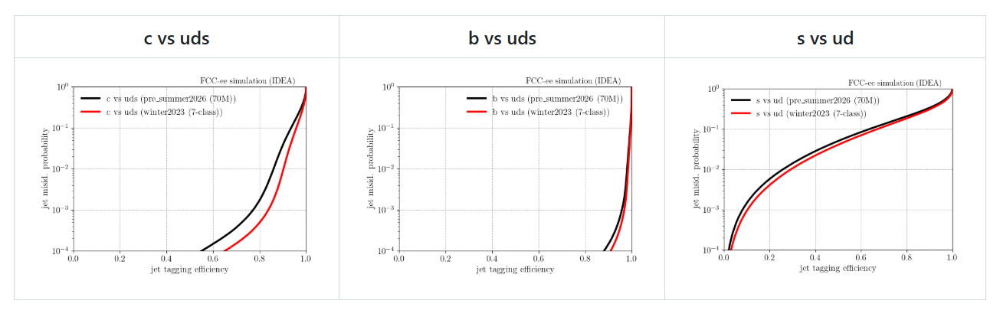

| script                  | role                                                                    | in → out                            |
| ----------------------- | ----------------------------------------------------------------------- | ----------------------------------- |
| `analysis_inference.py` | cluster + features + tagger inference (writes 7 scores)                 | edm4hep → `events` tree             |
| `plot_rocs.py`          | binary-discriminant ROC curves from inference scores                    | inference trees → `plots/roc_*.png` |
| `stage_plots.py`        | input-feature data/MC overlays with ratio panels                        | stage2 ntuples → PNGs               |
#### Inference and ROC curves

```sh
# per-flavour inference ntuples (7 scores per jet) — one run per flavour sample
fccanalysis run examples/FCCee/weaver/analysis_inference.py \
    --output <dir>/wzp6_ee_nunuH_Hbb_ecm240/events.root \
    --files-list <edm4hep>/wzp6_ee_nunuH_Hbb_ecm240/events_*.root --ncpus 8

# ROC curves from those score trees (edit the model dirs at the top of the script)
python examples/FCCee/weaver/plot_rocs.py         # full statistics, multi-threaded
ROC_NFILES=1 python examples/FCCee/weaver/plot_rocs.py   # quick test, 1 file/flavour
```

`plot_rocs.py` compares two model variants over a set of signal-vs-background flavour
pairs; the background score is the sum over the listed flavours, so composite backgrounds
(e.g. `uds`, `ud`) use `D(sig,bkg) = score_sig / (score_sig + Σ score_bkg)`.

Example ROC curves (pre_summer2026 70M vs winter2023 7-class):

