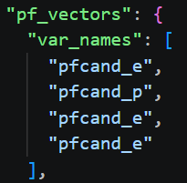

I first performed a tiny trial test with only 1,000 events to make sure I understood how to actually use the pipeline, ensuring the data prepares correctly and familiarising myself with the training process and using GPUs in the cluster.

#### <ins>At first:</ins>
- Kept everything as similar as possible to the model and weights that were provided in the tutorial
- Used their preprocessing json file to ensure I trained the model on the exact same features, kept their standardisation parameters, same number of jet constituents used too (75)

- One change I did make was here. pf_vectors expects \[px, py, pz, E] so I wasn't sure why here it was set to \[E, p, E, E]. This meant defining get_pX() functions in FCCAnalyses/analysers/JetConstituentsUtils and including them in FCCAnalyses/addons/ONNXruntime/python/JetFlavorHelper.py 
- Labels were set as \[S, C, B, D, U, G]
- Training was done over full wzp6_ee_nunuH_H*.root datasets (automatic 80/20 train/validate)
- Because I held no data back for testing, and because the tutorial tagger is tested over the ZH data (although small) I will test my models on this same data benchmarked against the tagger provided

The model trained and exported fine.

I plugged it into the tutorial and found that pretty much every jet had no score, just NaN. Only 5/1000 jets actually had scores. These scores did sum to 1 though, so something went right.

My first thought was something to do with the padding. The root files store the data per jet, as an array of its constituents. These arrays are jagged. But for the model to use them these arrays need to be the same length and so get padded with 0s up to the length set in the config file, in this case 75. I found the number of constituents in the jets which returned scores and those which returned NaNs.

All scored jets: N constituents > 75
All NaN jets: N constituents < 75

This confirmed that there must be something going wrong with the padding and how this gets handled somewhere along the line.

From the onnx and json provided in the tutorial, I could find which version of pytorch they used to export the model.

Their version: 1.X, opset=13
My version: 2.X, opset=15

They used a different version, and also a different opset.

I didn't want to change my version of torch in case this caused me other problems, particularly compatibility with the GPUs. But this gave me a direction to look towards to solve the problem.

After a lot of digging, I found that in my version of pytorch there is a function atan2(x, y) which computes arctan(x/y) for various quadrants depending on x and y. But when both x and y are passed as zero, this returns NaN. In previous versions this would return 0.

When evaluating atan2() between padded features, these all return NaN.

To fix this I edited ParticleTransformer.py inside of weaver. Wherever this function appears, it checks if x and y are both 0, and if so return 0.

I ran the model with this fix in place and all jets were successfully scored with the scores summing to 1. My first model had been successfully trained.

#### <ins>Things to change:</ins>
- Rather than training on only 75 constituents, train on every single one
- Change the preprocessing method to auto so that feature standardisation parameters are calculated on my dataset rather than taken from theirs
- Investigate the track fitting and covariance parameters

