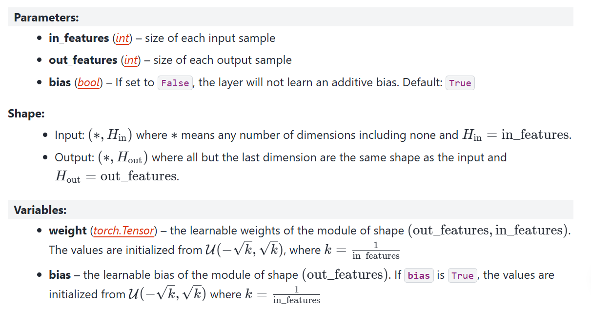
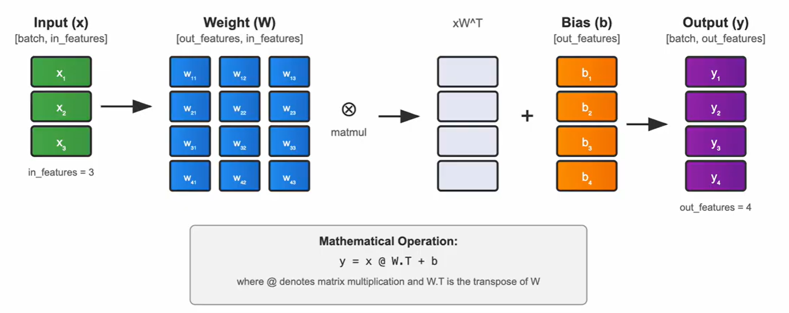
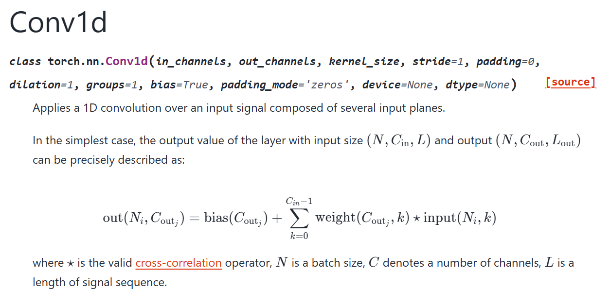
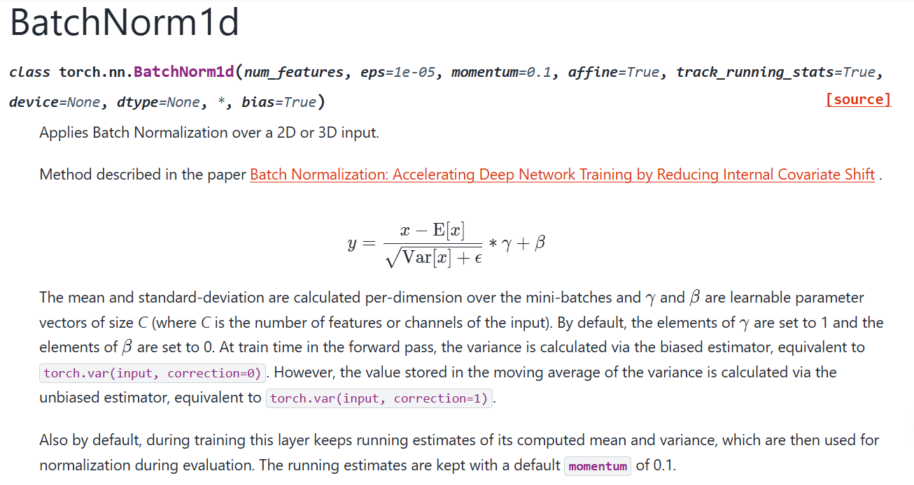

### Particle Embedding

input_dim = number of features
dims = \[128, 512, 128] by default

ParticleTransformer.py
``` python hl:22-34
class Embed(nn.Module):
    def __init__(self, input_dim, dims, normalize_input=True, activation="gelu", use_conv_embed=False):
        super().__init__()


        self.input_bn = nn.BatchNorm1d(input_dim) if normalize_input else None
        self.use_conv_embed = bool(use_conv_embed)
        if self.use_conv_embed:
            assert normalize_input == True
            module_list = []
            for dim in dims:
                module_list.extend(
                    [
                        nn.Conv1d(input_dim, dim, 1, bias=False),
                        nn.BatchNorm1d(dim),
                        nn.GELU() if activation == "gelu" else nn.ReLU(),
                    ]
                )
                input_dim = dim
            self.conv_embed = nn.Sequential(*module_list[:-1])
            self.embed = nn.Identity()
        else:
            module_list = []
            for dim in dims:
                module_list.extend(
                    [
                        nn.LayerNorm(input_dim),
                        nn.Linear(input_dim, dim),
                        nn.GELU() if activation == "gelu" else nn.ReLU(),
                    ]
                )
                input_dim = dim
            self.conv_embed = nn.Identity()
            self.embed = nn.Sequential(*module_list)


    def forward(self, x):
        if self.input_bn is not None:
            # x: (batch, embed_dim, seq_len)
            x = self.input_bn(x)
            x = self.conv_embed(x)
            x = x.transpose(1, 2).contiguous()
        # x: (batch, seq_len, embed_dim)
        return self.embed(x)
```

#### nn.LayerNorm(input_dim)


https://docs.pytorch.org/docs/2.15/generated/torch.nn.LayerNorm.html

https://arxiv.org/pdf/1607.06450

#### nn.Linear(input_dim, dim)




https://docs.pytorch.org/docs/2.15/generated/torch.nn.Linear.html



https://youtu.be/AmgBoQjEAZY?si=eNccVKeEsrpXZKnF

### Pairwise embedding

pairwise_lv_dim = depends on type
pairwise_lv_type = 'pp' (change to 'ee')
dims = \[64, 64, 64, num_heads] by default
num_heads = 8 by default

The heads get fed to separate attention layers

``` python hl:27-38,40-54
class PairEmbed(nn.Module):
    def __init__(
        self,
        pairwise_lv_dim,
        pairwise_input_dim,
        dims,
        pairwise_lv_type="pp",
        remove_self_pair=False,
        use_pre_activation_pair=True,
        normalize_input=True,
        activation="gelu",
        use_bias=True,
        eps=1e-8,
        for_onnx=False,
        sparse_eval=(True, True),
    ):
        super().__init__()

        self.pairwise_lv_dim = pairwise_lv_dim
        self.pairwise_input_dim = pairwise_input_dim
        self.remove_self_pair = remove_self_pair
        self.for_onnx = for_onnx
        self.sparse_eval = (False, False) if for_onnx else sparse_eval  # flags are for (train, inference)
        self.tril_indices_fn = tril_indices if self.for_onnx else torch.tril_indices
        self.out_dim = dims[-1]

        if pairwise_lv_type == "pp":
            self.is_symmetric = (pairwise_lv_dim <= 5) and (pairwise_input_dim == 0)
            self.pairwise_lv_fts = partial(pairwise_lv_fts_pp, num_outputs=pairwise_lv_dim, eps=eps)
        elif pairwise_lv_type == "ee":
            self.is_symmetric = (pairwise_lv_dim <= 6) and (pairwise_input_dim == 0)
            self.pairwise_lv_fts = partial(pairwise_lv_fts_ee, num_outputs=pairwise_lv_dim, eps=eps)
        elif pairwise_lv_type.startswith("xyzt"):
            coords = pairwise_lv_type.split(":")[1] if ":" in pairwise_lv_type else None
            self.is_symmetric = (pairwise_lv_dim <= 3) and (pairwise_input_dim == 0)
            self.pairwise_lv_fts = partial(pairwise_lv_fts_xyzt, num_outputs=pairwise_lv_dim, coords=coords, eps=eps)
        else:
            raise RuntimeError("Invalid value for `pairwise_lv_type`: " + pairwise_lv_type)

        if pairwise_lv_dim > 0:
            input_dim = pairwise_lv_dim
            module_list = [nn.BatchNorm1d(input_dim)] if normalize_input else []
            for dim in dims:
                module_list.extend(
                    [
                        nn.Conv1d(input_dim, dim, 1, bias=use_bias),
                        nn.BatchNorm1d(dim),
                        nn.GELU() if activation == "gelu" else nn.ReLU(),
                    ]
                )
                input_dim = dim
            if use_pre_activation_pair:
                module_list = module_list[:-1]
            self.embed = nn.Sequential(*module_list)

        if pairwise_input_dim > 0:
            input_dim = pairwise_input_dim
            module_list = [nn.BatchNorm1d(input_dim)] if normalize_input else []
            for dim in dims:
                module_list.extend(
                    [
                        nn.Conv1d(input_dim, dim, 1, bias=use_bias),
                        nn.BatchNorm1d(dim),
                        nn.GELU() if activation == "gelu" else nn.ReLU(),
                    ]
                )
                input_dim = dim
            if use_pre_activation_pair:
                module_list = module_list[:-1]
            self.fts_embed = nn.Sequential(*module_list)

    def _embed_pairs(self, x, uu):
        """Run embedding networks on pair features. Returns (batch_or_1, out_dim, num_pairs)."""
        elements = None
        if x is not None:
            elements = self.embed(x)
        if uu is not None:
            fts = self.fts_embed(uu)
            elements = fts if elements is None else elements + fts
        return elements

    def _forward_dense(self, x, uu=None, mask=None):
        # x: (batch, v_dim, seq_len)
        # uu: (batch, v_dim, seq_len, seq_len)
        if x is not None:
            batch_size, _, seq_len = x.size()
        else:
            batch_size, _, seq_len, _ = uu.size()

        if self.is_symmetric:
            i, j = self.tril_indices_fn(
                seq_len,
                seq_len,
                offset=-1 if self.remove_self_pair else 0,
                device=(x if x is not None else uu).device,
            )
            if x is not None:
                xi = x[:, :, i]  # (batch, dim, num_tril_pairs)
                xj = x[:, :, j]
                x = self.pairwise_lv_fts(xi, xj)
            if uu is not None:
                # (batch, dim, num_tril_pairs)
                uu = uu[:, :, i, j]
        else:
            if x is not None:
                x = self.pairwise_lv_fts(x.unsqueeze(-1), x.unsqueeze(-2))
                if self.remove_self_pair:
                    diag_idx = torch.arange(0, seq_len, device=x.device)
                    x[:, :, diag_idx, diag_idx] = 0
                x = x.reshape(batch_size, self.pairwise_lv_dim, seq_len * seq_len)
            if uu is not None:
                uu = uu.reshape(batch_size, self.pairwise_input_dim, seq_len * seq_len)

        elements = self._embed_pairs(x, uu)

        if self.is_symmetric:
            y = elements.new_zeros(batch_size, self.out_dim, seq_len, seq_len)
            y[:, :, i, j] = elements
            y[:, :, j, i] = elements
        else:
            y = elements.reshape(batch_size, self.out_dim, seq_len, seq_len)
        return y

    def _forward_sparse(self, x, uu=None, mask=None):
        # x: (batch, v_dim, seq_len)
        # uu: (batch, v_dim, seq_len, seq_len)
        if x is not None:
            batch_size, _, seq_len = x.size()
        else:
            batch_size, _, seq_len, _ = uu.size()

        i0, i2, i3 = (Ellipsis,) * 3
        if mask is not None:
            pair_mask = mask.unsqueeze(-1) * mask.unsqueeze(-2)  # (batch_size, 1, seq_len, seq_len)
            if self.is_symmetric:
                offset = -1 if self.remove_self_pair else 0
                i0, _, i2, i3 = pair_mask.float().tril(offset).nonzero(as_tuple=True)
            else:
                i0, _, i2, i3 = pair_mask.nonzero(as_tuple=True)

        if x is not None:
            x = self.pairwise_lv_fts(x.unsqueeze(-1), x.unsqueeze(-2))
            x = x.permute(0, 2, 3, 1)[i0, i2, i3, :]  # (num_elements, pairwise_lv_dim)
            x = x.T.unsqueeze(0)  # (1, pairwise_lv_dim, num_elements)
        if uu is not None:
            uu = uu.permute(0, 2, 3, 1)[i0, i2, i3, :]  # (num_elements, pairwise_input_dim)
            uu = uu.T.unsqueeze(0)  # (1, pairwise_input_dim, num_elements)

        elements = self._embed_pairs(x, uu)
        elements = elements.squeeze(0).T  # (num_elements, out_dim)

        y = torch.zeros(batch_size, seq_len, seq_len, self.out_dim, dtype=elements.dtype, device=elements.device)
        y[i0, i2, i3, :] = elements
        if self.is_symmetric:
            y[i0, i3, i2, :] = elements
        y = y.permute(0, 3, 1, 2).contiguous()

        return y

    def forward(self, x, uu=None, mask=None):
        sparse_eval = self.sparse_eval[0 if self.training else 1]
        if sparse_eval and mask is not None:
            return self._forward_sparse(x, uu=uu, mask=mask)
        else:
            return self._forward_dense(x, uu=uu, mask=mask)

```

#### nn.conv1d(input_dim, dim, 1, bias=use_bias)



https://docs.pytorch.org/docs/2.15/generated/torch.nn.Conv1d.html

https://en.wikipedia.org/wiki/Cross-correlation

Performs a point-wise (kernel size = 1) 1D convolutional embedding

eg - first convolutional embedding from 6 to 64 for one pair:

Input shape = (6)

Weights shape = (64, 6)

Bias shape = (64)

Output shape = (64)

#### nn.BatchNorm1d(dim)



https://docs.pytorch.org/docs/2.15/generated/torch.nn.BatchNorm1d.html

https://arxiv.org/abs/1502.03167

Same as LayerNorm but normalised over the batch instead 