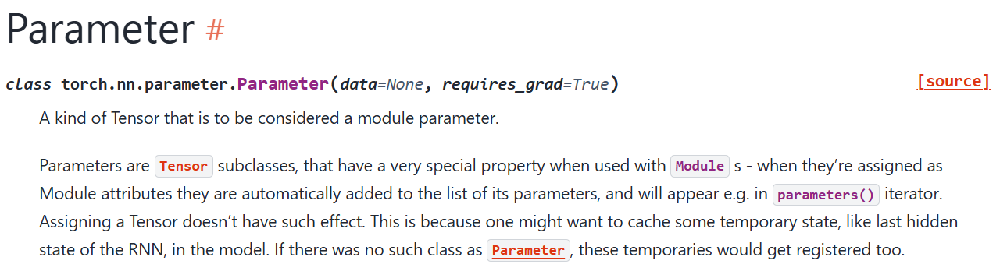

``` python
class ParticleTransformer(nn.Module):
	def __init__(
		
        if num_cls_layers > 0:
            cfg_cls_block = copy.deepcopy(default_cfg)
            cfg_cls_block.update({"dropout": 0, "attn_dropout": 0, "activation_dropout": 0})
            if cls_block_params is not None:
                cfg_cls_block.update(cls_block_params)
            _logger.info("cfg_cls_block: %s" % str(cfg_cls_block))
```

uib

``` python
class ParticleTransformer(nn.Module):
	def __init__(
	    
	    if self.include_global_token or (not self.for_segmentation and num_cls_layers > 0):
            self.cls_token = nn.Parameter(torch.zeros(1, 1, embed_dim), requires_grad=True)
            nn.init.trunc_normal_(self.cls_token, std=0.02)
        else:
            self.cls_token = None
```



Generates the class token as a learnable parameter

``` python
class ParticleTransformer(nn.Module):
	def _forward_aggregator(self, x, padding_mask):
        
        elif self.cls_blocks is not None:
            # for classification: extract using class token
            cls_tokens = self.cls_token.expand(x.size(0), -1, -1)  # (batch, 1, embed_dim)
            for block in self.cls_blocks:
                cls_tokens = block(x, x_cls=cls_tokens, padding_mask=padding_mask)  # (batch, 1, embed_dim)
            cls_tokens = cls_tokens.squeeze(1)  # (batch, embed_dim)
            
        x_cls = self.norm(cls_tokens)  # (batch, embed_dim)
        return x_cls
```

Expands the class token so that its dimensions match

When it is concatenated only adds 1 to the sequence length

``` python
class ParticleTransformer(nn.Module):
	def forward(self, x, v=None, mask=None, uu=None, uu_idx=None):
        
        x_cls = self._forward_aggregator(x, padding_mask)
        if self.fc is None:
            return x_cls

        # fc
        output = self.fc(x_cls)
        if self.for_inference:
            output = torch.softmax(output, dim=1)
        # print('output:\n', output)
        return output
```

