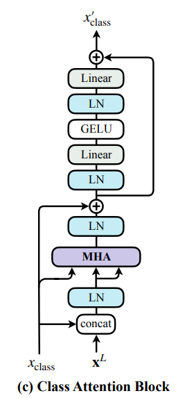

``` python
class ParticleTransformer(nn.Module):
	def __init__(
		
        if num_cls_layers > 0:
            cfg_cls_block = copy.deepcopy(default_cfg)
            cfg_cls_block.update({"dropout": 0, "attn_dropout": 0, "activation_dropout": 0})
            if cls_block_params is not None:
                cfg_cls_block.update(cls_block_params)
            _logger.info("cfg_cls_block: %s" % str(cfg_cls_block))
            
        self.cls_blocks = (
            nn.ModuleList([Block(**cfg_cls_block) for _ in range(num_cls_layers)]) if num_cls_layers > 0 else None
        )
```

Define the config for the classification block

Initialises classification blocks based on the number of layers set

``` python
class ParticleTransformer(nn.Module):
	def __init__(
	    
	    if self.include_global_token or (not self.for_segmentation and num_cls_layers > 0):
            self.cls_token = nn.Parameter(torch.zeros(1, 1, embed_dim), requires_grad=True)
            nn.init.trunc_normal_(self.cls_token, std=0.02)
        else:
            self.cls_token = None
```


Generates the class token as a learnable parameter

``` python
class ParticleTransformer(nn.Module):
	def forward(self, x, v=None, mask=None, uu=None, uu_idx=None):
        
        x_cls = self._forward_aggregator(x, padding_mask)
        if self.fc is None:
            return x_cls
```

Runs the attention classification, \_forward_aggregator()

``` python
class ParticleTransformer(nn.Module):
	def _forward_aggregator(self, x, padding_mask):
        
        elif self.cls_blocks is not None:
            # for classification: extract using class token
            cls_tokens = self.cls_token.expand(x.size(0), -1, -1)  # (batch, 1, embed_dim)
            for block in self.cls_blocks:
                cls_tokens = block(x, x_cls=cls_tokens, padding_mask=padding_mask)  # (batch, 1, embed_dim)
            cls_tokens = cls_tokens.squeeze(1)  # (batch, embed_dim)
            
        x_cls = self.norm(cls_tokens)  # (batch, embed_dim)
        return x_cls
```

Expands the class token so that its dimensions match

When it is concatenated only adds 1 to the sequence length

Passes the classification token and particle encodings through each attention classification block initialised at the start

``` python
class Block(nn.Module):
	def forward(self, x, x_cls=None, padding_mask=None, attn_mask=None):
	
        if x_cls is not None:
            with torch.no_grad():
                # prepend one element for x_cls: -> (batch, 1+seq_len)
                padding_mask = torch.cat((torch.zeros_like(padding_mask[:, :1]), padding_mask), dim=1)
            # class attention: https://arxiv.org/pdf/2103.17239.pdf
            residual = x_cls
            u = torch.cat((x_cls, x), dim=1)  # (batch, 1+seq_len, embed_dim)
            u = self.pre_attn_norm(u)
            x = self.attn(x_cls, u, u, key_padding_mask=padding_mask)[0]  # (batch, 1, embed_dim)
            
        x = self.post_attn_norm(x)
        x = self.dropout(x)
        x = self.drop_path1(self.ls1(x))
        x = x + residual

        residual = x
        x = self.pre_fc_norm(x)
        x = self.act_dropout(x)
        x = self.post_fc_norm(x)
        x = self.fc2(x)
        x = self.dropout(x)
        x = self.drop_path2(self.ls2(x))
        x = x + residual

        return x
```

The forward propagation for an attention block

Prepends the classification token

Runs attention with classification token as the query, and the particle encodings as the keys and values

Updates only the classification token based on the attention output

Applies the standard post-attention processing to the updated classification token

``` python
class ParticleTransformer(nn.Module):
	def forward(self, x, v=None, mask=None, uu=None, uu_idx=None):

        # fc
        output = self.fc(x_cls)
        if self.for_inference:
            output = torch.softmax(output, dim=1)
        # print('output:\n', output)
        return output
```

Runs the final classification following embedding, attention, classification layers

``` python hl:14-23
        if fc_params is not None:
            fcs = []
            in_dim = embed_dim
            for param in fc_params:
                try:
                    out_dim, drop_rate, act = param
                except ValueError:
                    (out_dim, drop_rate), act = param, "relu"
                if act == "swiglu":
                    layer = nn.Sequential(
                        SwiGLUFFN(in_dim, out_dim * 4, out_dim, drop=drop_rate, bias=default_cfg["use_bias"]),
                        norm_layer(out_dim),
                    )
                else:
                    layer = nn.Sequential(
                        nn.Linear(in_dim, out_dim, bias=default_cfg["use_bias"]),
                        nn.GELU() if act == "gelu" else nn.ReLU(),
                        nn.Dropout(drop_rate),
                    )
                fcs.append(layer)
                in_dim = out_dim
            fcs.append(nn.Linear(in_dim, num_classes))
            self.fc = nn.Sequential(*fcs)
        else:
            self.fc = None
```

Final classification token sent through one last MLP

Then projected down to a number of dimensions matching the number of classes